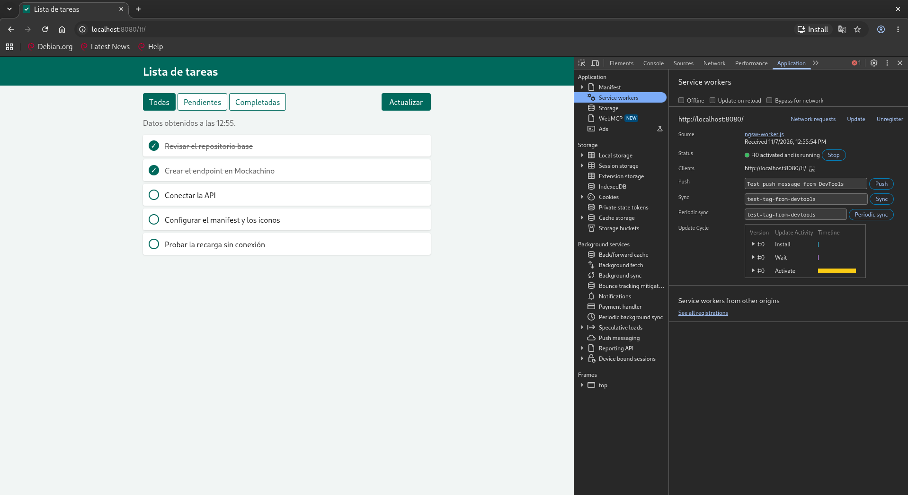
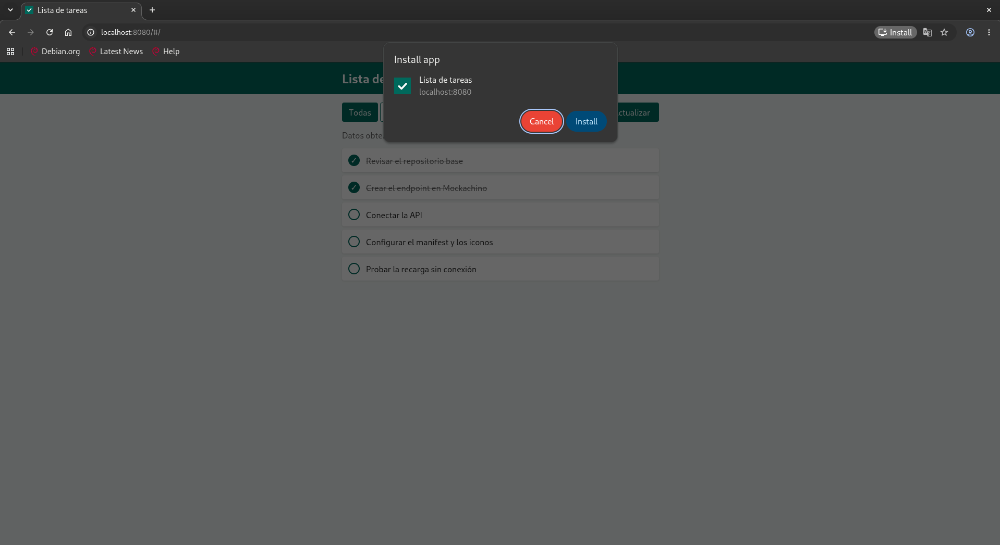
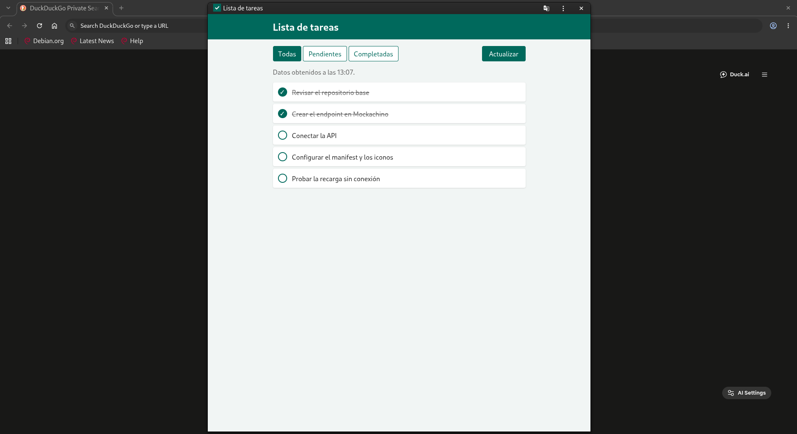
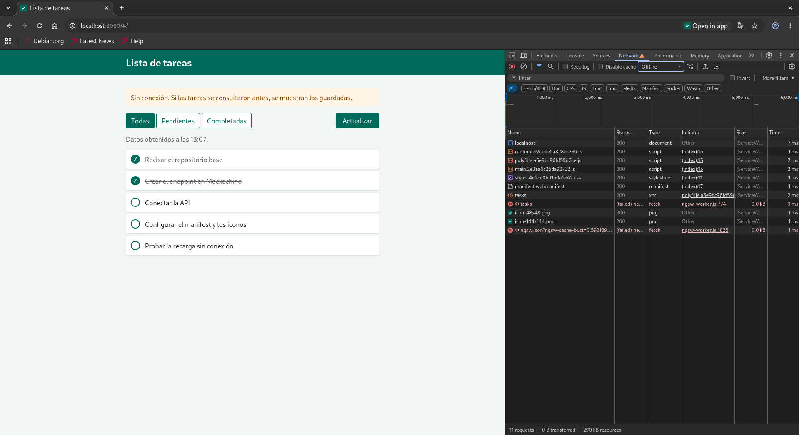

# Lista de tareas: PWA con Angular y API propia

Aplicación web progresiva para gestionar tareas que **funciona sin conexión**: los cambios se guardan en el dispositivo y se envían a una API propia (FastAPI + SQLite) cuando vuelve la red.

Basada en el repositorio de la cátedra [pwa-angular](https://github.com/fabiancontigliani/pwa-angular); el README original quedó en [docs/README-base.md](docs/README-base.md) y el enunciado en [docs/enunciado.md](docs/enunciado.md).

> **Alcance respecto del enunciado.** El enunciado pide como mínimo una aplicación de **consulta** y aclara que no hacen falta un backend propio, un CRUD completo ni la sincronización de cambios offline. Esta entrega los agrega como extensión. La versión de consulta, que leía la lista de Mockachino y la guardaba con el caché del service worker, quedó en la etiqueta [`v1-consulta`](../../tree/v1-consulta).

## Decisiones de diseño

### 1. Alternativa elegida y alcance

**Lista de tareas.** La aplicación permite:

- Ver las tareas y filtrarlas en el navegador: **Todas**, **Pendientes** o **Completadas**.
- **Crear** tareas, **marcarlas** como completadas o pendientes, **editar** el título y **borrarlas**.
- Hacer todo eso **sin conexión**: los cambios quedan en el dispositivo y se envían a la API al sincronizar.
- Ver el estado: conexión, cambios sin enviar y hora de la última sincronización.
- Recibir, si se activa, un **aviso del sistema** cuando los cambios llegan a la API.

Fuera del alcance: usuarios y autenticación, resolver conflictos entre varios dispositivos (gana la última escritura que recibe la API) y sincronizar con la aplicación cerrada (Background Sync o push).

### 2. Campos de cada elemento

| Campo | Tipo | Obligatorio | Descripción |
| --- | --- | --- | --- |
| `id` | texto (UUID) | Sí | Lo genera la aplicación con `crypto.randomUUID()`, para poder crear tareas sin conexión |
| `title` | texto | Sí | No puede quedar vacío; se quitan los espacios de los extremos |
| `completed` | booleano | Sí | `true` si la tarea está terminada |

La aplicación valida cada tarea que recibe de la API y de `localStorage`. La API rechaza con `422` un título vacío, un `completed` que no sea booleano, campos de más o un `id` que no sea un UUID.

### 3. API y estructura JSON

La API está en la carpeta [api/](api/) y se sirve en `http://localhost:8000`:

| Método y ruta | Respuesta |
| --- | --- |
| `GET /api/tasks` | `200` con `{"tasks": [...]}`, en orden de creación; lista vacía si no hay tareas |
| `GET /api/tasks/{id}` | `200` con la tarea, o `404` |
| `PUT /api/tasks/{id}` | Crea (`201`) o reemplaza (`200`) la tarea; devuelve la tarea completa |
| `DELETE /api/tasks/{id}` | `204`, exista o no la tarea |

```json
{
  "tasks": [
    { "id": "4e2590d7-4ab5-4aef-8e13-ff063cf82c3c", "title": "Conectar la API", "completed": false }
  ]
}
```

El cuerpo de `PUT` lleva solo `title` y `completed`; el `id` va en la URL.

**Por qué `PUT` y no `POST` para crear.** Los cambios hechos sin conexión se envían más tarde y pueden reintentarse: si la red se corta después de que la API guardó, pero antes de que llegue la respuesta, la aplicación vuelve a enviar el mismo cambio. Con `PUT` sobre el UUID que generó la aplicación, el reintento cae sobre la misma tarea y no la duplica. Con `POST`, cada reintento crearía otra tarea. Por la misma razón, `DELETE` responde `204` aunque la tarea ya no exista.

Las respuestas llevan `Cache-Control: no-store`, para que el navegador no las guarde en su caché HTTP, y CORS permite la aplicación en `localhost` o `127.0.0.1`, puertos `4200` y `8080`.

### 4. Información disponible sin conexión

- **La interfaz completa:** HTML, JavaScript, CSS, manifest e iconos, guardados por el service worker al instalarse.
- **Las tareas y los cambios sin enviar**, guardados en `localStorage`.
- **Todas las acciones:** filtrar, crear, marcar, editar y borrar. Los cambios se marcan como **Sin enviar** y el contador de la tarjeta de estado los suma.

Al volver la conexión, la aplicación sincroniza sola.

### 5. Sin datos, falla de la API y primera carga

| Situación | Qué muestra la aplicación |
| --- | --- |
| Sincronización en curso | "Sincronizando…" y el botón **Sincronizar** deshabilitado; barras de carga si todavía no hay tareas |
| La API devuelve una lista vacía | "No hay tareas." |
| El filtro no deja ninguna tarea | "No hay tareas pendientes." o "No hay tareas completadas." |
| Nunca se obtuvo la lista y la API no responde | "Se necesita conexión con la API para la primera carga de datos." y **Reintentar** |
| Sin conexión, con tareas en el dispositivo | Las tareas guardadas, sin mensaje de error: la tarjeta de estado indica "Sin conexión" |
| La API no responde y hay cambios sin enviar | "No se pudo conectar con la API. Los cambios quedan guardados en este dispositivo." y **Reintentar** |
| La API rechaza un cambio (`4xx`) | Se descarta ese cambio, queda la versión del servidor y se avisa qué tarea fue |
| La respuesta no tiene el formato del punto 3 | Error de formato; no se reemplaza la lista |
| La copia de `localStorage` está dañada | Se descarta, se avisa y la lista se vuelve a descargar de la API |

Además:

- El estado de **Conexión** usa `navigator.onLine` y los eventos `online`/`offline`. Es orientativo: estar "En línea" no garantiza que la API responda.
- Nunca se muestran datos de ejemplo escritos en el código en lugar de los de la API o del dispositivo.

### 6. Cambios locales

Se guardan en `localStorage`, en la clave `lista-de-tareas.v1`:

```json
{
  "tasks": [{ "id": "…", "title": "…", "completed": false }],
  "pending": { "<id>": "save", "<otro id>": "delete" },
  "lastSyncAt": 1794060409920
}
```

- Cada cambio se aplica primero en pantalla y en `localStorage`, y la tarea queda marcada como pendiente: `save` (enviar la versión local con `PUT`) o `delete` (enviar un `DELETE`).
- Hay **una marca por tarea**, no una lista de operaciones: si una tarea se edita tres veces sin conexión, se envía un solo `PUT` con la última versión. Como `PUT` y `DELETE` se pueden repetir sin efectos de más, el orden entre tareas distintas no importa.
- **Sincronizar** envía cada pendiente y después pide la lista completa con `GET`. Si mientras tanto se hizo otro cambio, se aplica encima de la lista del servidor y se envía en la vuelta siguiente.
- Se sincroniza al abrir la aplicación, al volver la conexión, después de cada cambio con conexión y con el botón **Sincronizar**.

Para **restablecer**: pulsar **Sincronizar** con la API disponible deja todo igual al servidor. **Clear site data** (DevTools → **Application** → **Storage**) borra `localStorage`, **incluidos los cambios sin enviar**. Para vaciar la API, detenerla y borrar `api/data/tasks.db`.

## Requisitos

- Node.js **22.x** y npm. Versiones usadas: Node **22.23.4** y npm **10.9.9**. Con [nvm](https://github.com/nvm-sh/nvm), `nvm use` toma la versión de `.nvmrc`.
- Python **3.11** o posterior para la API. Versión usada: **3.13.5**.
- Chrome o Edge de escritorio para instalar la aplicación y probarla sin conexión.

## Instalación y ejecución local

Se necesitan dos terminales: una para la API y otra para la aplicación.

### API (`http://localhost:8000`)

```bash
cd api
python3 -m venv .venv
.venv/bin/python -m pip install -r requirements.txt
.venv/bin/uvicorn app.main:app --port 8000
```

La documentación interactiva queda en <http://localhost:8000/docs>. **Ctrl+C** detiene la API; las tareas se conservan en `api/data/tasks.db`.

Variables opcionales: `DATABASE_PATH` (por defecto `./data/tasks.db`) y `CORS_ORIGINS` (por defecto `localhost` y `127.0.0.1` en los puertos `4200` y `8080`; para el navegador son orígenes distintos).

Pruebas de la API:

```bash
cd api
.venv/bin/python -m pip install -r requirements-dev.txt
.venv/bin/python -m pytest
```

### Aplicación

```bash
npm ci
```

Compilación de producción servida como PWA en `http://localhost:8080`:

```bash
npm run serve:pwa
```

Desarrollo en `http://localhost:4200`, sin service worker ni avisos del sistema:

```bash
npm start
```

> El `package-lock.json` del repositorio base no coincidía con su `package.json` y `npm ci` fallaba. Se regeneró con `npm install` sin cambiar las versiones de Angular (18.2.14).

## Service worker y datos sin conexión

El service worker se genera con [Workbox](https://developer.chrome.com/docs/workbox) en lugar del service worker de Angular (`@angular/service-worker`), que se quitó del proyecto.

### Equivalencia con assetGroups y dataGroups

El enunciado propone configurar el service worker de Angular en `ngsw-config.json`, que separa el caché en dos tipos de grupos:

| Responsabilidad | Service worker de Angular | Esta entrega |
| --- | --- | --- |
| Guardar los archivos para **abrir la aplicación** | `assetGroups` con `installMode: prefetch` | Precaché de Workbox (`globPatterns`) |
| Guardar los **datos** para consultarlos sin conexión | `dataGroups` (respuestas de la API en Cache Storage) | `localStorage`, desde la aplicación |

**Por qué los datos no van en el caché del service worker.** Un caché de respuestas solo guarda lo que respondió el servidor: no puede guardar una tarea creada sin conexión que todavía no se envió. Además, si el service worker devolviera una respuesta vieja del caché cuando la aplicación pide la lista después de sincronizar, la aplicación la tomaría como la lista del servidor y podría hacer reaparecer tareas borradas. Por eso hay una sola copia local, en `localStorage`, y la API responde con `Cache-Control: no-store`.

En la versión de consulta ([`v1-consulta`](../../tree/v1-consulta)), los datos sí se guardaban en el service worker, con `runtimeCaching` y la estrategia `NetworkFirst` (equivalente a `freshness`).

### Cómo se genera y se registra

1. `npm run build` ejecuta `ng build` y después `workbox generateSW workbox-config.js`.
2. Workbox lee [workbox-config.js](workbox-config.js), recorre la carpeta compilada y escribe `sw.js` (más un archivo `workbox-<hash>.js` con la librería) en `dist/pwa-api-cache/browser/`.
3. [src/main.ts](src/main.ts) registra `sw.js` con `navigator.serviceWorker.register('sw.js')`, solo en producción (`!isDevMode()`).

Con `skipWaiting` y `clientsClaim`, el service worker toma el control de la página apenas se activa, sin esperar a que se cierren las pestañas.

### Precaché: la interfaz

`globPatterns` indica qué archivos se guardan **al instalar** el service worker: `index.html`, JavaScript, CSS, manifest e iconos (`assets/**/*.png`). Quedan en el caché `workbox-precache-v2-...`. Workbox guarda cada archivo con una revisión; al compilar una versión nueva, solo vuelve a descargar los que cambiaron.

### Avisos del sistema

Con el permiso concedido, al terminar una sincronización que envió cambios la aplicación le pide al service worker que muestre un aviso ("Se enviaron 2 cambios a la API.") con `registration.showNotification`. Son avisos locales, no notificaciones push: solo aparecen con la aplicación abierta.

- El permiso se pide únicamente con el botón **Activar avisos** de la tarjeta de estado, nunca al abrir la aplicación.
- Si el permiso está bloqueado, la tarjeta explica cómo habilitarlo desde los permisos del sitio.
- En desarrollo (`npm start`) no hay service worker y la opción no aparece.

## Instalación de la PWA y pruebas

Usar Chrome o Edge de escritorio, con la API levantada y la compilación de producción (`npm run serve:pwa`) abierta en `http://localhost:8080`.

### 1. Primera carga con conexión

1. Abrir `http://localhost:8080`, crear algunas tareas y comprobar que "Cambios sin enviar" vuelve a `0`.
2. En DevTools → **Application** → **Service Workers**, comprobar que `sw.js` figura como *activated and is running*.
3. En **Cache Storage**, comprobar el caché `workbox-precache-v2-http://localhost:8080/` (interfaz).
4. En **Local Storage** → `http://localhost:8080`, comprobar la clave `lista-de-tareas.v1` (tareas y pendientes).
5. En <http://localhost:8000/docs> (o con `curl http://localhost:8000/api/tasks`), comprobar que las tareas llegaron a la API.

### 2. Manifest e instalación

1. En **Application** → **Manifest** comprobar el nombre "Lista de tareas", el nombre corto "Tareas", los iconos y la URL de inicio, sin errores.
2. Instalar desde el icono de instalación de la barra de direcciones (o menú ⋮ → **Instalar Lista de tareas**).
3. Abrir la app instalada y comprobar que se abre en una ventana propia, con el nombre y el icono del tilde.

### 3. Cambios sin conexión

1. En DevTools → **Network** activar **Offline**.
2. Crear una tarea, marcar otra y borrar una tercera. Cada una queda con la etiqueta **Sin enviar** y el contador "Cambios sin enviar" sube.
3. Recargar sin borrar datos: la interfaz, las tareas y los cambios pendientes siguen ahí.
4. Comprobar en la API que todavía no llegaron.
5. Desactivar **Offline**: la aplicación sincroniza sola, el contador vuelve a `0` y la API tiene los cambios.

### 4. API caída

1. Detener la API (**Ctrl+C**) y hacer un cambio: aparece "No se pudo conectar con la API. Los cambios quedan guardados en este dispositivo.".
2. Volver a levantar la API y pulsar **Reintentar** o **Sincronizar**.

### 5. Primera carga sin datos

1. Con la API detenida, en **Application** → **Storage** pulsar **Clear site data** y recargar.
2. Aparece "Se necesita conexión con la API para la primera carga de datos.".

### 6. Avisos del sistema

1. Pulsar **Activar avisos** y aceptar el permiso.
2. Hacer un cambio sin conexión y volver a conectarse: aparece el aviso "Se envió 1 cambio a la API.".

### Reiniciar desde cero

**Clear site data** borra el service worker, el caché y `localStorage` (incluidos los cambios sin enviar). Después hay que volver a abrir la aplicación con conexión.

## Limitaciones

- **Hace falta una primera visita con conexión** para que el service worker guarde la interfaz, y la API tiene que responder al menos una vez para obtener la lista.
- **El service worker tiene que terminar de guardar la interfaz.** Si se pierde la conexión mientras descarga los archivos, la instalación falla y se vuelve a intentar en la próxima visita con conexión.
- **Solo sincroniza con la aplicación abierta.** Si la API vuelve a funcionar sin que cambie la conexión del navegador, hay que pulsar **Sincronizar**.
- **`localStorage` no es un respaldo.** Borrar los datos del sitio elimina los cambios sin enviar, y el navegador limita su tamaño (unos 5 MB).
- **Un cambio rechazado por la API se pierde** y hay que rehacerlo. La aplicación valida el título antes de guardarlo, así que no debería ocurrir en el uso normal.
- **Una sola pestaña a la vez.** Dos pestañas abiertas comparten `localStorage` pero no se avisan entre sí, y la última que guarda pisa la copia de la otra.
- **Sin resolución de conflictos** entre dispositivos: gana la última escritura que recibe la API.
- **Los avisos del sistema** solo aparecen con la aplicación abierta, en la compilación de producción, y el modo "No molestar" del sistema puede ocultarlos.

## Evidencias

> **Pendiente:** estas capturas son de la versión de consulta ([`v1-consulta`](../../tree/v1-consulta)), con la interfaz anterior. Falta repetirlas con esta versión: lista cargada, aplicación instalada, cambios sin conexión y sincronización al volver la conexión.








